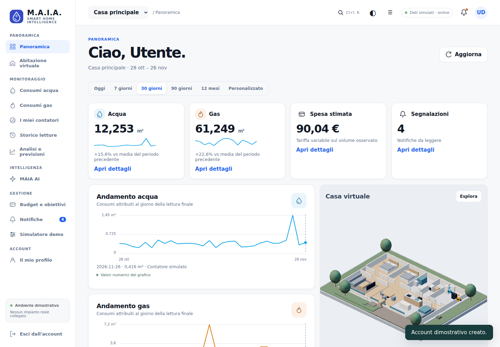

# M.A.I.A. 4.0 · Smart Home Intelligence

**Monitora. Comprendi. Prevedi.**

M.A.I.A. monitora i consumi sintetici di acqua e gas di un’abitazione virtuale. Puoi esplorare stanze e contatori, azionare dispositivi dimostrativi e vedere gli effetti su letture, budget, previsioni e report. L’accesso demo crea un account isolato con circa due anni di letture simulate.



[Accesso](docs/screenshots/accesso.png) · [Casa virtuale](docs/screenshots/casa.png) · [Analisi 3D](docs/screenshots/analisi.png) · [Assistente](docs/screenshots/assistente.png) · [Mobile](docs/screenshots/mobile.png)

## Avvio rapido

Con Python 3.12+ e Node.js 22+:

```bash
bash start.sh
```

Apri la porta **8000** su localhost o il forwarding privato di GitHub Codespaces. Da **Esplora la demo** puoi usare tutte le funzioni statistiche e del simulatore. La configurazione opzionale è in `.env.example`.

## Cosa puoi fare

- Consultare andamento, letture cumulative, consumi del periodo, avvisi e stime variabili dei costi.
- Esplorare la casa in Three.js con mouse o touch e passare alla pianta interattiva.
- Registrare cicli demo e consultare i consumi attribuiti a ciascuna stanza dagli eventi.
- Esplorare barre e superfici 3D con alternativa 2D, filtri temporali e previsioni a 7 o 30 giorni.
- Configurare tariffa e obiettivi, confrontare ipotesi di risparmio, esportare PDF e CSV.
- Usare MAIA AI con cronologia persistente, oppure attivare un modello linguistico con tool calling.
- Gestire abitazioni, profilo, TOTP e notifiche Web Push opzionali.

## Attiva il modello linguistico

Imposta `MAIA_AI_PROVIDER=openai`, `MAIA_AI_MODEL` e `OPENAI_API_KEY`, oppure avvia Ollama, scarica un modello che supporta gli strumenti e imposta `MAIA_AI_PROVIDER=ollama` e `MAIA_AI_MODEL`. Lancia `python -m scripts.ai_check` nello stesso ambiente configurato prima del riavvio. [Configurazione completa dei provider](docs/AI.md)

## Architettura e cartelle

FastAPI e SQLAlchemy gestiscono API, WebSocket, SQLite o PostgreSQL. Il frontend usa moduli JavaScript, CSS e Three.js. Scikit-learn esegue Isolation Forest. ReportLab compone i PDF.

| Cartella | Contenuto |
|---|---|
| `backend/` | API, sessioni, simulazione, statistica, chat e report |
| `frontend/` | Applicazione web, grafici, design system e vista 3D |
| `scripts/` | Build asset, backup, verifica AI e collaudo browser |
| `tests/` | Test Python su database temporaneo |
| `docs/` | Documentazione e screenshot |

## Guide

- [Architettura](docs/ARCHITECTURE.md)
- [Database, migrazioni, backup e ripristino](docs/DATABASE.md)
- [Simulatore, modello 3D e licenze](docs/DIGITAL_TWIN.md)
- [API](docs/API.md)
- [Test e benchmark](docs/TESTING.md)
- [Docker, MQTT, PWA, Codespaces e risoluzione problemi](docs/DEPLOYMENT.md)
- [Changelog](CHANGELOG.md) e [stato delle fasi](TASKS.md)

## Limiti del prototipo

I dati sono sintetici. Costi e risparmi dipendono da tariffe e ipotesi esplicite. Le fasce di previsione descrivono la variabilità delle osservazioni e le segnalazioni indicano variazioni da consultare. L’app opera con contatori e impianti dimostrativi. Il grafo 3D rappresenta un’unica casa a un piano. Il supporto di ogni combinazione fra provider, modello, browser e dispositivo richiede un collaudo dedicato.

Per i controlli della dashboard, del modellino e della chat, consulta la [guida dell’interfaccia e la galleria](docs/ESPERIENZA.md).
